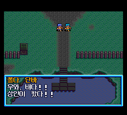

# 05. 대사 그리기

## 12픽셀 칸

대사 글꼴은 12×12 픽셀이고, 공백을 포함한 모든 글자가 똑같이 12픽셀 한 칸을 차지합니다. 반칸 글자는 없습니다. 글자 모양은 시스템 카드 안에 글자당 18바이트로 들어 있고, 게임은 이것을 4픽셀 단위로 밀어 가며 화면 타일에 합성합니다.

## 줄 나누기

원문 대사는 줄 끝마다 줄바꿈 기호가 박혀 있습니다. 한국어 문장은 길이도 낱말 경계도 다르기 때문에, 빌더는 줄을 다시 나눕니다. 순서는 이렇습니다.

1. 문장 단위로 다시 배치합니다.
2. 안 되면 어절 단위로 다시 배치합니다.
3. 그래도 안 되면 한 줄에 쓸 수 있는 바이트에 맞추어 띄어쓰기를 줄입니다.

한 줄의 너비는 원문에서 가장 긴 줄보다 두 칸 넓게 잡습니다.

## 화면

에뮬레이터 창만 원래 크기로 찍었습니다. 화자 이름과 두 줄 대사가 원래 틀 안에 그대로 들어갑니다.

다음: [06. 한글화 방식](06_한글화방식.md)
